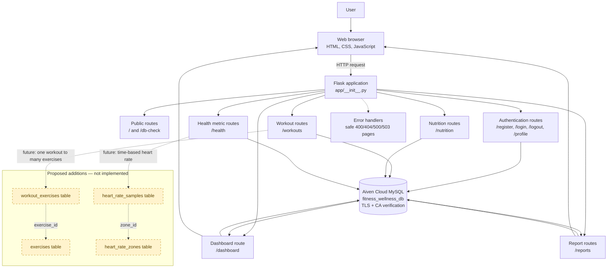
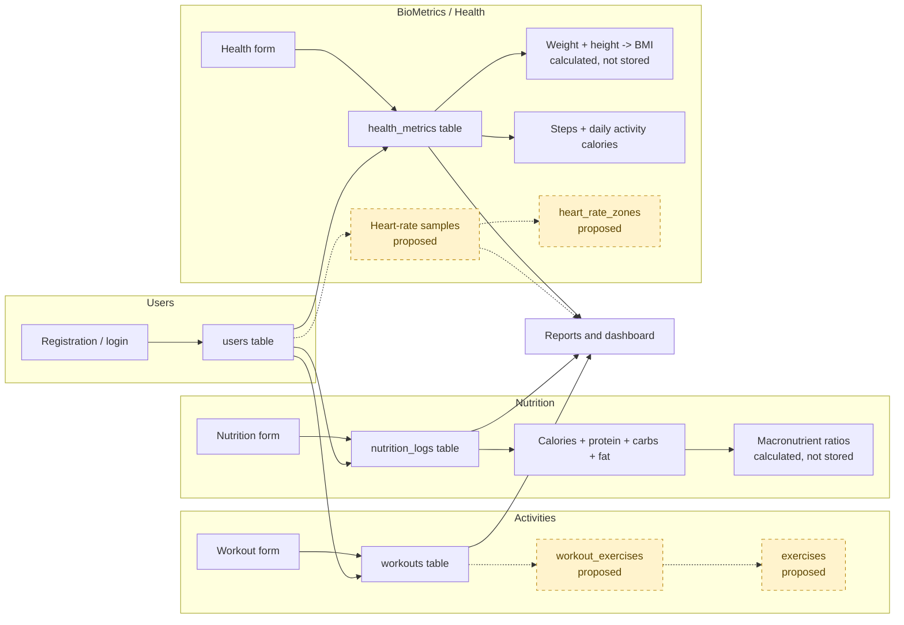

# FitTrack — High-Level Logic Flow

**Project:** FitTrack — Fitness & Wellness Tracking Database System  
**Milestone:** 1 — Entity Identification & Logic Mapping  
**Purpose:** show how a user request moves through the existing Flask application to the Aiven MySQL database and back to the dashboard and reports.

> **Scope note:** This diagram describes the **current implementation**. The proposed `exercises`, `workout_exercises`, `heart_rate_samples`, and `heart_rate_zones` tables are shown only inside the dashed “Proposed — not implemented” area. They are not part of the running application.

---

## 1. High-level flow diagram

---

## 2. Implemented request flow

| Step | What happens | Evidence |
|---:|---|---|
| 1 | The user opens a page in the browser. | `app/templates/` |
| 2 | Flask receives the request and loads the session user. | `app/__init__.py`, `load_logged_in_user()` |
| 3 | Public pages render without a database call. | `app/routes/main.py` |
| 4 | Registration and login validate input, hash or verify the password, and use the `users` table. | `app/routes/auth.py`, `users` |
| 5 | Protected routes require a logged-in user. | `app/utils.py`, `login_required()` |
| 6 | Workout create/edit/delete writes only the signed-in user's rows in `workouts`. | `app/routes/workouts.py`, `workouts` |
| 7 | Nutrition create/edit/delete writes only the signed-in user's rows in `nutrition_logs`. | `app/routes/nutrition.py`, `nutrition_logs` |
| 8 | Health create/edit/delete writes only the signed-in user's rows in `health_metrics`; BMI is calculated from weight and height. | `app/routes/health.py`, `health_metrics` |
| 9 | The dashboard runs aggregate queries for the signed-in user and renders live totals. | `app/routes/dashboard.py`, `app/templates/dashboard.html` |
| 10 | Reports run daily, weekly, monthly, calorie, weight and BMI aggregates. | `app/routes/reports.py`, `app/templates/reports/index.html` |
| 11 | Database errors are converted into safe error pages; raw MySQL messages are not shown. | `app/__init__.py` error handlers |
| 12 | All personal queries filter by `user_id = %s`, so users cannot read or change another user's records. | `app/routes/*.py`, `app/db.py` |

---

## 3. Data flow by category

---

## 4. What the diagram deliberately does not claim

- There is **no** exercise catalogue or workout-exercise junction in the running application.
- There is **no** heart-rate capture, heart-rate zone calculation, or time-based health record in the running application.
- There is **no** charting library or visual analytics page; reports are table-based.
- There is **no** separate analytics service or external API.
- Nutrition time-of-day is **not** captured; only `log_date` exists.

These are documented as proposed items in `docs/DATA_DICTIONARY.md` and `docs/MILESTONE_1_REPORT.md`.

---

## 5. Diagram-to-code map

| Diagram node | Actual file or database object |
|---|---|
| Browser | `app/templates/`, `app/static/` |
| Flask application | `app/__init__.py`, `run.py` |
| Public routes | `app/routes/main.py` |
| Authentication routes | `app/routes/auth.py` |
| Workout routes | `app/routes/workouts.py` |
| Nutrition routes | `app/routes/nutrition.py` |
| Health metric routes | `app/routes/health.py` |
| Dashboard | `app/routes/dashboard.py` |
| Reports | `app/routes/reports.py` |
| Database | Aiven MySQL `fitness_wellness_db` |
| Error handlers | `app/__init__.py` |
| Proposed exercise tables | Not implemented |
| Proposed heart-rate tables | Not implemented |

---

**Document status:** Created for Milestone 1.  
**Related documents:** `docs/DATA_DICTIONARY.md`, `docs/MILESTONE_1_REPORT.md`.
