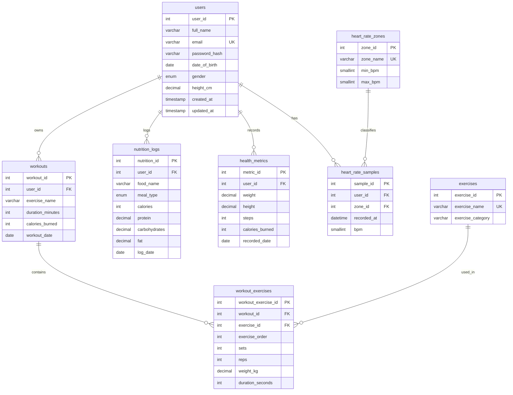

# Milestone 1 Report — Entity Identification & Logic Mapping

**Project:** FitTrack — Fitness & Wellness Tracking Database System  
**Folder:** `D:\ictproject\fitnesstrack`  
**Database:** Aiven Cloud MySQL `fitness_wellness_db` (MySQL `8.4.11`)  
**Milestone:** 1 of 4  
**Status:** Milestone 1 documentation completed; proposed entities are **design only** and are not implemented.  
**Audit basis:** Live read-only schema inspection, `database/aiven_init.sql`, the Flask routes, templates, and `Fitness_Wellness_Project_Requirement_Audit.md`.

> **Strict-rule compliance:** No application source file was modified. No table was created or altered. No row was inserted, updated, or deleted. No dummy data was generated. The Aiven database is unchanged.

---

## 1. Objective

Identify and document the entities, attributes, primary keys, foreign keys, relationships, and cardinalities for the Fitness & Wellness Tracking Database System, then map how the existing application moves data from the user through Flask to Aiven MySQL and back to the dashboard and reports.

The Milestone 1 deliverables are:

- `docs/DATA_DICTIONARY.md`
- `docs/LOGIC_FLOW.md`
- `docs/MILESTONE_1_REPORT.md` (this file)

The exercise and heart-rate structures are **proposed** for later implementation. They are not part of the running database.

---

## 2. Evidence inspected

| Evidence | What it confirms |
|---|---|
| Live `information_schema` metadata | Four existing tables and their exact columns, types, nullability, defaults, keys, and constraints. |
| Live `SELECT COUNT(*)` | `users = 1`, `workouts = 0`, `nutrition_logs = 0`, `health_metrics = 0`. |
| `database/aiven_init.sql` | Current DDL for the four existing tables. |
| `app/routes/workouts.py` | Workouts use one free-text `exercise_name` and do not support multiple exercises. |
| `app/routes/nutrition.py` | Nutrition stores one food item per row with calories, protein, carbohydrates, fat, and `log_date`; no time of day. |
| `app/routes/health.py` | Health stores weight, height, steps, calories, and `recorded_date`; BMI is calculated in SQL, not stored. |
| `app/routes/dashboard.py` | Dashboard reads live aggregates from Aiven MySQL. |
| `app/routes/reports.py` | Reports use daily, weekly, monthly, and health aggregates; no charts and no heart-rate reports. |
| `app/__init__.py` | Blueprint registration, session user loading, and safe database error handling. |
| `docs/archive/*` | Obsolete five-table/local-MySQL design; not used as current evidence. |

---

## 3. Existing entities

| Entity | Purpose | Existing table | Primary key | Foreign keys | Relationships | Implemented? |
|---|---|---|---|---|---|---|
| Users | Registered user profile and authentication identity | `users` | `user_id` | None | One user to many workouts, nutrition logs, and health records | **Yes** |
| Workouts | One workout session per row | `workouts` | `workout_id` | `user_id` → `users.user_id` | Many workouts belong to one user | **Yes** |
| Nutrition logs | One food item per row | `nutrition_logs` | `nutrition_id` | `user_id` → `users.user_id` | Many nutrition logs belong to one user | **Yes** |
| Health metrics | One daily health snapshot per user | `health_metrics` | `metric_id` | `user_id` → `users.user_id` | Many records belong to one user, at most one per day | **Yes** |

**Category mapping**

| Mentor category | Existing entity |
|---|---|
| Users | `users` |
| Activities / Workouts | `workouts` |
| Nutrition | `nutrition_logs` |
| BioMetrics / Health | `health_metrics` |

**Existing attribute summary**

- `users`: `user_id`, `full_name`, `email`, `password_hash`, `date_of_birth`, `gender`, `height_cm`, `created_at`, `updated_at`.
- `workouts`: `workout_id`, `user_id`, `exercise_name`, `duration_minutes`, `calories_burned`, `workout_date`.
- `nutrition_logs`: `nutrition_id`, `user_id`, `food_name`, `meal_type`, `calories`, `protein`, `carbohydrates`, `fat`, `log_date`.
- `health_metrics`: `metric_id`, `user_id`, `weight`, `height`, `steps`, `calories_burned`, `recorded_date`.

Full types, nullability, defaults, constraints and descriptions are in `docs/DATA_DICTIONARY.md`.

---

## 4. Proposed entities

| Entity | Purpose | Proposed table | Primary key | Foreign keys | Relationships | Implemented? |
|---|---|---|---|---|---|---|
| Exercises | Reusable exercise catalogue | `exercises` | `exercise_id` | None | One exercise to many workout-exercise entries | **No — proposed** |
| Workout exercises | Junction between a workout and its exercises | `workout_exercises` | `workout_exercise_id` | `workout_id` → `workouts`; `exercise_id` → `exercises` | Many entries per workout; many entries per exercise | **No — proposed** |
| Heart-rate zones | Reference table for zone boundaries | `heart_rate_zones` | `zone_id` | None | One zone to many heart-rate samples | **No — proposed** |
| Heart-rate samples | Time-based heart-rate readings | `heart_rate_samples` | `sample_id` | `user_id` → `users`; `zone_id` → `heart_rate_zones` | Many samples per user; many samples per zone | **No — proposed** |

**Optional Milestone 2 normalization idea:** a `foods` lookup table could replace free-text `nutrition_logs.food_name`. It is not required for Milestone 1 and is deliberately not included in the core proposed entity set.

---

## 5. Attributes

The complete attribute list, with data types, nullability, defaults, keys and descriptions, is in `docs/DATA_DICTIONARY.md`.

**Existing entities**

| Entity | Attributes |
|---|---|
| `users` | `user_id`, `full_name`, `email`, `password_hash`, `date_of_birth`, `gender`, `height_cm`, `created_at`, `updated_at` |
| `workouts` | `workout_id`, `user_id`, `exercise_name`, `duration_minutes`, `calories_burned`, `workout_date` |
| `nutrition_logs` | `nutrition_id`, `user_id`, `food_name`, `meal_type`, `calories`, `protein`, `carbohydrates`, `fat`, `log_date` |
| `health_metrics` | `metric_id`, `user_id`, `weight`, `height`, `steps`, `calories_burned`, `recorded_date` |

**Proposed entities**

| Entity | Attributes |
|---|---|
| `exercises` | `exercise_id`, `exercise_name`, `exercise_category` |
| `workout_exercises` | `workout_exercise_id`, `workout_id`, `exercise_id`, `exercise_order`, `sets`, `reps`, `weight_kg`, `duration_seconds` |
| `heart_rate_zones` | `zone_id`, `zone_name`, `min_bpm`, `max_bpm` |
| `heart_rate_samples` | `sample_id`, `user_id`, `zone_id`, `recorded_at`, `bpm` |

---

## 6. Primary keys

| Entity | Primary key | Type | Status |
|---|---|---|---|
| `users` | `user_id` | `INT UNSIGNED AUTO_INCREMENT` | Existing |
| `workouts` | `workout_id` | `INT UNSIGNED AUTO_INCREMENT` | Existing |
| `nutrition_logs` | `nutrition_id` | `INT UNSIGNED AUTO_INCREMENT` | Existing |
| `health_metrics` | `metric_id` | `INT UNSIGNED AUTO_INCREMENT` | Existing |
| `exercises` | `exercise_id` | `INT UNSIGNED AUTO_INCREMENT` | Proposed |
| `workout_exercises` | `workout_exercise_id` | `INT UNSIGNED AUTO_INCREMENT` | Proposed |
| `heart_rate_zones` | `zone_id` | `INT UNSIGNED AUTO_INCREMENT` | Proposed |
| `heart_rate_samples` | `sample_id` | `INT UNSIGNED AUTO_INCREMENT` | Proposed |

---

## 7. Foreign keys

| Child entity | Foreign key column | Parent entity | Parent column | Proposed delete rule | Status |
|---|---|---|---|---|---|
| `workouts` | `user_id` | `users` | `user_id` | Existing: `ON DELETE CASCADE` | Existing |
| `nutrition_logs` | `user_id` | `users` | `user_id` | Existing: `ON DELETE CASCADE` | Existing |
| `health_metrics` | `user_id` | `users` | `user_id` | Existing: `ON DELETE CASCADE` | Existing |
| `workout_exercises` | `workout_id` | `workouts` | `workout_id` | Proposed: `ON DELETE CASCADE` | Proposed |
| `workout_exercises` | `exercise_id` | `exercises` | `exercise_id` | Proposed: `ON DELETE RESTRICT` | Proposed |
| `heart_rate_samples` | `user_id` | `users` | `user_id` | Proposed: `ON DELETE CASCADE` | Proposed |
| `heart_rate_samples` | `zone_id` | `heart_rate_zones` | `zone_id` | Proposed: `ON DELETE SET NULL` | Proposed |

All three existing foreign keys also use `ON UPDATE CASCADE`.

---

## 8. Relationship mapping

| Entity A | Relationship | Entity B | Cardinality | Foreign key | Explanation |
|---|---|---|---|---|---|
| `users` | owns | `workouts` | 1 : N | `workouts.user_id` → `users.user_id` | One user can have many workouts; each workout belongs to exactly one user. |
| `workouts` | contains | `workout_exercises` | 1 : N | `workout_exercises.workout_id` → `workouts.workout_id` | One workout can contain many exercise entries; each entry belongs to one workout. |
| `exercises` | is used in | `workout_exercises` | 1 : N | `workout_exercises.exercise_id` → `exercises.exercise_id` | One catalogue exercise can appear in many workouts; each entry references one exercise. |
| `workouts` | many-to-many with | `exercises` | M : N | Resolved by `workout_exercises` | A workout has many exercises, and an exercise can appear in many workouts. |
| `users` | logs | `nutrition_logs` | 1 : N | `nutrition_logs.user_id` → `users.user_id` | One user can log many food items; each log belongs to one user. |
| `users` | records | `health_metrics` | 1 : N | `health_metrics.user_id` → `users.user_id` | One user can have many daily health records; each record belongs to one user. |
| `users` | has | `heart_rate_samples` | 1 : N | `heart_rate_samples.user_id` → `users.user_id` | One user can have many time-based heart-rate readings. |
| `heart_rate_zones` | classifies | `heart_rate_samples` | 1 : N | `heart_rate_samples.zone_id` → `heart_rate_zones.zone_id` | One zone can classify many readings; each reading has at most one zone. |
| `users` | analytical link by user and date | `nutrition_logs`, `workouts`, `health_metrics` | Not a declared FK | Same `user_id` plus date | Used for dashboard and report comparisons such as intake versus expenditure. This is an analytical join, not a foreign key. |

### Cardinality summary

- **One user → many workouts:** implemented.
- **One workout → many exercises:** designed through `workout_exercises`, not implemented.
- **One user → many nutrition logs:** implemented.
- **One user → many health metric records:** implemented, at most one per user per day.
- **One user → many heart-rate samples:** proposed.
- **One heart-rate zone → many samples:** proposed.

---

## 9. Exercise structure

### 9.1 Current implementation

The live `workouts` table contains:

```text
workout_id, user_id, exercise_name, duration_minutes, calories_burned, workout_date
```

`exercise_name` is a `VARCHAR(100)` free-text field. Each workout row stores exactly one exercise label. There is:

- no `exercises` table,
- no `workout_exercises` table,
- no sets, reps, weight, exercise duration, or exercise order,
- no way to represent multiple exercises in one workout.

### 9.2 Proposed structure

```text
workouts
  workout_id (PK)
  user_id (FK -> users)
  duration_minutes
  calories_burned
  workout_date
       |
       | 1:N
       v
workout_exercises
  workout_exercise_id (PK)
  workout_id (FK -> workouts)
  exercise_id (FK -> exercises)
  exercise_order
  sets
  reps
  weight_kg
  duration_seconds
       ^
       | 1:N
       |
exercises
  exercise_id (PK)
  exercise_name (UNIQUE)
  exercise_category
```

**Why each attribute exists**

| Attribute | Justification |
|---|---|
| `exercise_id` | Stable identity for an exercise, so the name is stored once. |
| `exercise_name` | Human-readable name required by the mentor's exercise requirement. |
| `exercise_category` | The mentor asks for exercise category; supports grouping and filtering. |
| `workout_id` | Connects an exercise entry to its workout session. |
| `exercise_id` | Connects the entry to the exercise catalogue. |
| `exercise_order` | Preserves the order of exercises inside one workout. |
| `sets` | Captures strength-training volume. |
| `reps` | Captures repetitions per set. |
| `weight_kg` | Captures load, with an explicit kilogram unit. |
| `duration_seconds` | Captures timed/cardio exercise duration without overloading the session-level `duration_minutes`. |

**Why `workout_exercise_id` rather than a composite primary key**

- It follows the existing surrogate-key style (`workout_id`, `nutrition_id`, `metric_id`).
- A proposed `UNIQUE (workout_id, exercise_order)` constraint preserves ordering and prevents duplicate positions within a workout.
- If the mentor prefers a composite key, `(workout_id, exercise_id, exercise_order)` is a valid alternative for Milestone 2. That decision belongs in the normalization report.

### 9.3 Relationship to the existing `workouts.exercise_name`

- `exercise_name` is the current denormalized representation and must be treated as **legacy**.
- Proposed migration, only after approval:
  1. Create `exercises` and `workout_exercises`.
  2. Insert one `exercises` row per distinct existing `exercise_name`.
  3. Create `workout_exercises` rows for existing workouts.
  4. Update the Flask workout form and routes to write the junction table.
  5. Keep `exercise_name` temporarily for backward compatibility.
  6. Deprecate or remove it in a later, separately approved migration.
- **No column is dropped or renamed in Milestone 1.**

---

## 10. Health metrics

### 10.1 Existing fields

`health_metrics` currently contains:

| Field | Type | Purpose |
|---|---|---|
| `metric_id` | `INT UNSIGNED` | Primary key. |
| `user_id` | `INT UNSIGNED` | Foreign key to `users`. |
| `weight` | `DECIMAL(5,2)` | Body weight in kilograms. |
| `height` | `DECIMAL(5,2)` | Height in centimetres. |
| `steps` | `INT UNSIGNED` | Daily steps. |
| `calories_burned` | `INT UNSIGNED` | Daily activity calories. |
| `recorded_date` | `DATE` | Daily snapshot date. |

### 10.2 Support assessment

| Requirement | Existing support | Proposed support | Status |
|---|---|---|---|
| Weight | `health_metrics.weight` | None needed. | Existing |
| BMI | Derived from `weight` and `height` in SQL and `app/utils.py`. | Optional stored/generated BMI column if the mentor wants persistence. | Existing (derived) |
| Calories | `nutrition_logs.calories` (intake), `workouts.calories_burned` (session), `health_metrics.calories_burned` (daily activity). | Define one authoritative expenditure source to avoid double counting. | Existing fields; definition needs clarification |
| Steps | `health_metrics.steps` | None needed. | Existing |
| Heart rate | None. | `heart_rate_samples.bpm`. | **Proposed** |
| Heart-rate zones | None. | `heart_rate_zones` + `heart_rate_samples.zone_id`. | **Proposed** |
| Time-based records | `recorded_date` is date-only; one record per day. | `heart_rate_samples.recorded_at DATETIME`. | **Proposed** |

### 10.3 BMI formula

```text
BMI = weight_kg / ((height_cm / 100) * (height_cm / 100))
```

The current application rounds BMI to one decimal place. BMI is not stored. If a generated column is chosen in Milestone 2, it must use the same formula and rounding rule.

### 10.4 Heart-rate design scope

- `heart_rate_samples` stores raw time-stamped readings.
- `heart_rate_zones` stores global default BPM boundaries.
- Per-user zones (based on age or measured maximum heart rate) are a possible Milestone 2 refinement; they are not modeled in this draft.
- Zone assignment must be validated by the application or a controlled process because MySQL CHECK constraints cannot compare a row to another table.

---

## 11. Nutrition

### 11.1 Existing fields

`nutrition_logs` currently contains:

| Field | Type | Purpose |
|---|---|---|
| `nutrition_id` | `INT UNSIGNED` | Primary key. |
| `user_id` | `INT UNSIGNED` | Foreign key to `users`. |
| `food_name` | `VARCHAR(120)` | Free-text food item. |
| `meal_type` | `ENUM('Breakfast','Lunch','Dinner','Snack')` | Meal category. |
| `calories` | `INT UNSIGNED` | Energy intake. |
| `protein` | `DECIMAL(6,1)` | Protein in grams. |
| `carbohydrates` | `DECIMAL(6,1)` | Carbohydrates in grams. |
| `fat` | `DECIMAL(6,1)` | Fat in grams. |
| `log_date` | `DATE` | Intake date. |

### 11.2 Support assessment

| Requirement | Supported? | Evidence / gap |
|---|---|---|
| Calories | Yes | `nutrition_logs.calories`. |
| Protein | Yes | `nutrition_logs.protein`. |
| Carbohydrates | Yes | `nutrition_logs.carbohydrates`. |
| Fats | Yes | `nutrition_logs.fat`. |
| Food intake | Yes, at one-item-per-row level | `food_name` is free text; there is no `foods` catalogue. |
| Date | Yes | `log_date DATE`. |
| Time | **No** | Only a date is stored; no time-of-day column or input. |
| Macronutrient ratios | **Yes, calculable** | Protein, carbohydrate and fat grams are all present. No ratio is stored or reported. |

### 11.3 Macronutrient ratio calculation

Using Atwater factors:

```text
protein_kcal      = protein_g * 4
carbohydrate_kcal = carbohydrates_g * 4
fat_kcal          = fat_g * 9
total_macro_kcal  = protein_kcal + carbohydrate_kcal + fat_kcal

protein_ratio_pct      = protein_kcal      / NULLIF(total_macro_kcal, 0) * 100
carbohydrate_ratio_pct = carbohydrate_kcal / NULLIF(total_macro_kcal, 0) * 100
fat_ratio_pct          = fat_kcal          / NULLIF(total_macro_kcal, 0) * 100
```

No schema change is required to calculate these ratios from existing fields. A dedicated ratio query/report is still missing and belongs to Milestone 3/4.

**Accuracy caveat:** stored `calories` may differ from macro-derived energy because of fibre, alcohol, rounding, or label data. Reports must state which denominator they use.

### 11.4 Proposed optional time field

If the mentor requires meal timing, a later migration can add `logged_at DATETIME` or `log_time TIME` to `nutrition_logs`. This is **not** implemented and is not required to calculate current daily totals. The decision should be made in Milestone 2.

---

## 12. Entity relationship overview (Mermaid draft)

**Legend**

- **Existing entities:** `users`, `workouts`, `nutrition_logs`, `health_metrics`.
- **Proposed entities:** `exercises`, `workout_exercises`, `heart_rate_zones`, `heart_rate_samples`.
- Mermaid ER diagrams do not support dashed entity boxes, so proposed entities are identified in the table below and in the data dictionary. This is an initial draft; the finalized Crow's Foot ERD belongs to Milestone 2.



**Entity status table**

| Entity | Status | Implemented in live DB? |
|---|---|---|
| `users` | Existing | Yes |
| `workouts` | Existing | Yes |
| `nutrition_logs` | Existing | Yes |
| `health_metrics` | Existing | Yes |
| `exercises` | Proposed | No |
| `workout_exercises` | Proposed | No |
| `heart_rate_zones` | Proposed | No |
| `heart_rate_samples` | Proposed | No |

---

## 13. Data Dictionary status

**File:** `docs/DATA_DICTIONARY.md`  
**Status:** **Created.**

It contains:

- a complete table for every existing entity (`users`, `workouts`, `nutrition_logs`, `health_metrics`);
- a complete table for every proposed entity (`exercises`, `workout_exercises`, `heart_rate_zones`, `heart_rate_samples`);
- the requested columns: Entity, Attribute, Data type, Primary key, Foreign key, Nullable, Default, Description, Existing or proposed;
- exact live types for existing fields;
- explicit “Proposed” labels for unbuilt fields;
- constraint, relationship, BMI, calorie, time-based, and macronutrient-ratio notes.

It does not claim that any proposed table or field exists.

---

## 14. Logic Flow Diagram status

**File:** `docs/LOGIC_FLOW.md`  
**Status:** **Created.**

It contains:

- a Mermaid flowchart from User → Browser → Flask → Authentication / Workouts / Nutrition / Health Metrics → Aiven MySQL → Dashboard → Reports;
- a second data-flow diagram grouped by Users, Activities, Nutrition, and BioMetrics;
- a step-by-step implemented request flow with file evidence;
- a diagram-to-code map;
- a clearly marked “Proposed — not implemented” area for exercises and heart-rate tables.

The diagram does not claim that the proposed modules exist.

---

## 15. Missing requirements after Milestone 1

| Missing requirement | Why it is still missing | Belongs to |
|---|---|---|
| `exercises` table | Proposed only; not in the live database. | Milestone 2/3 |
| `workout_exercises` table | Proposed only; one workout still cannot store many exercises. | Milestone 2/3 |
| Exercise UI and CRUD | Application still edits one free-text `exercise_name`. | Milestone 3 |
| Heart-rate capture | No `heart_rate_samples` table, route, form, or device integration. | Milestone 2/3 |
| Heart-rate zone calculation | No zone table, thresholds, or time-in-zone report. | Milestone 2/3 |
| Time-of-day nutrition | `log_date` is date-only. | Milestone 2 decision |
| Stored/generated BMI | BMI is calculated but not persisted. | Milestone 2 decision |
| Macronutrient ratio report | Ratios are calculable but not reported. | Milestone 3/4 |
| Final Crow's Foot ERD | This report contains only a draft ER diagram. | Milestone 2 |
| Normalization report | Not created yet. | Milestone 2 |
| Physical schema blueprint | Not created yet. | Milestone 2 |
| 1,000+ data and performance tests | Not part of Milestone 1. | Milestone 4 |
| Application changes for proposed entities | Prohibited in this milestone. | Milestone 3 |

---

## 16. Milestone 1 completion status

| # | Requirement | Status | Evidence |
|---:|---|---|---|
| 1 | Identify main database entities | PASS | Section 3 and Section 4. |
| 2 | Categorize Users, Activities, Nutrition, BioMetrics | PASS | Category mapping in Section 3. |
| 3 | Identify attributes for each entity | PASS | Section 5 and `docs/DATA_DICTIONARY.md`. |
| 4 | Define primary keys | PASS | Section 6. |
| 5 | Define foreign keys | PASS | Section 7. |
| 6 | Define relationships | PASS | Section 8. |
| 7 | Define relationship cardinalities | PASS | Section 8. |
| 8 | Model one user having many workouts | PASS | Existing `workouts.user_id` FK. |
| 9 | Model one workout containing many exercises | PARTIAL | Designed as `workout_exercises`; not implemented in the live DB. |
| 10 | Model one user having many nutrition logs | PASS | Existing `nutrition_logs.user_id` FK. |
| 11 | Model one user having many health metric records | PASS | Existing `health_metrics.user_id` FK and daily unique rule. |
| 12 | Include real-time or time-based health metrics such as heart-rate zones | PARTIAL | Designed as `heart_rate_samples` + `heart_rate_zones`; not implemented. |
| 13 | Include macronutrient ratios | PARTIAL | Calculable from existing protein/carbohydrate/fat fields; no ratio report yet. |
| 14 | Prepare a comprehensive Data Dictionary | PASS | `docs/DATA_DICTIONARY.md` created. |
| 15 | Prepare a high-level Logic Flow Diagram | PASS | `docs/LOGIC_FLOW.md` created. |

**Milestone 1 documentation status:** complete for the 15 requirements, with 12 PASS and 3 PARTIAL.  
**Implementation status:** the proposed exercise and heart-rate entities remain unimplemented by design.  
**Database status:** unchanged.  
**Application status:** unchanged.

---

## 17. Recommendations for Milestone 2

1. **Finalize the ER diagram in Crow's Foot notation**, using the live four-table schema plus the four proposed entities. Show PKs, FKs, cardinalities, and the M:N resolution through `workout_exercises`.
2. **Write the normalization report** covering 1NF, 2NF, and 3NF for every table. Explain why `workout_exercises` is a junction table and justify its key choice.
3. **Decide the `workouts.exercise_name` migration policy**: keep temporarily, backfill into `exercises`/`workout_exercises`, then deprecate. Do not drop it without approval.
4. **Decide heart-rate zone scope**: global default thresholds versus per-user zones based on age or measured maximum heart rate.
5. **Decide whether nutrition needs time-of-day** (`logged_at DATETIME` or `log_time TIME`). Document the effect on daily aggregation.
6. **Decide whether BMI should remain derived** or become a stored/generated column. If generated, use the same formula and rounding as the application.
7. **Define proposed constraints and indexes** for the new tables: unique exercise name, unique workout/exercise order, CHECK ranges for sets/reps/weight/bpm, and an index on `heart_rate_samples (user_id, recorded_at)`.
8. **Prepare migration SQL as a draft only.** Do not execute it until the mentor approves the Milestone 2 design.
9. **Update the Data Dictionary and Logic Flow** after each design decision so the documents stay consistent with the final model.
10. **Keep the archive documents out of the current deliverable set.** `docs/archive/DATABASE_DESIGN_v1.md` describes a five-table design that does not match the live database.

---

## 18. Final Milestone 1 summary

**Existing entities:** `users`, `workouts`, `nutrition_logs`, `health_metrics`.

**Proposed entities:** `exercises`, `workout_exercises`, `heart_rate_zones`, `heart_rate_samples`.

**Existing relationships**

- One user → many workouts.
- One user → many nutrition logs.
- One user → many health metric records.

**Designed relationships (not implemented)**

- One workout → many exercises through `workout_exercises`.
- Many workouts ↔ many exercises through `workout_exercises`.
- One user → many heart-rate samples.
- One heart-rate zone → many heart-rate samples.

**Data Dictionary:** created at `docs/DATA_DICTIONARY.md`.

**Logic Flow Diagram:** created at `docs/LOGIC_FLOW.md`.

**Missing requirements:** implementation of exercises/workout-exercises, heart-rate samples/zones, time-of-day nutrition decision, macronutrient-ratio report, final Crow's Foot ERD, normalization report, physical schema blueprint, and Milestone 3/4 application, data, analytics, and performance work.

**Milestone 1 completion:** documentation complete (12 PASS, 3 PARTIAL across the 15 requirements). The database and application were not modified.

**Recommended next step:** obtain approval of this Milestone 1 result, then begin Milestone 2 with the finalized Crow's Foot ERD and normalization report. Do not implement the proposed tables until Milestone 2 is approved.

---

**End of Milestone 1 report.**
